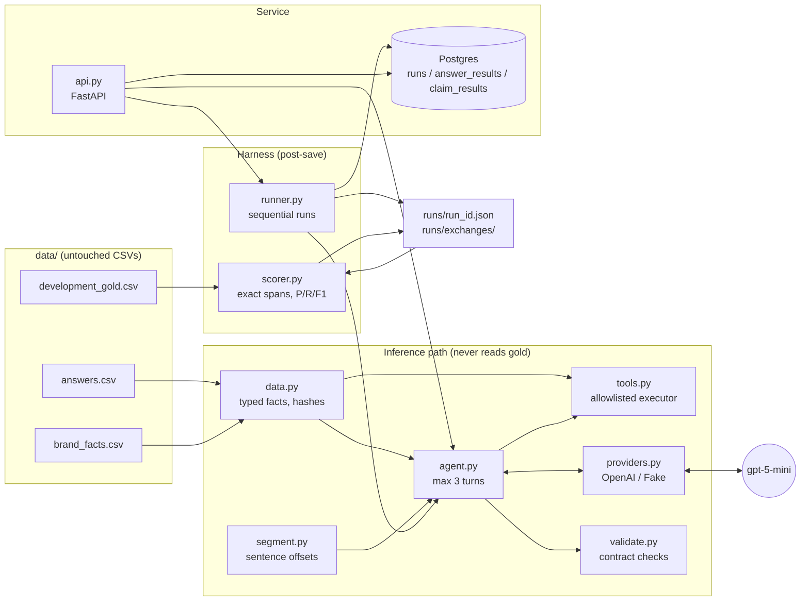
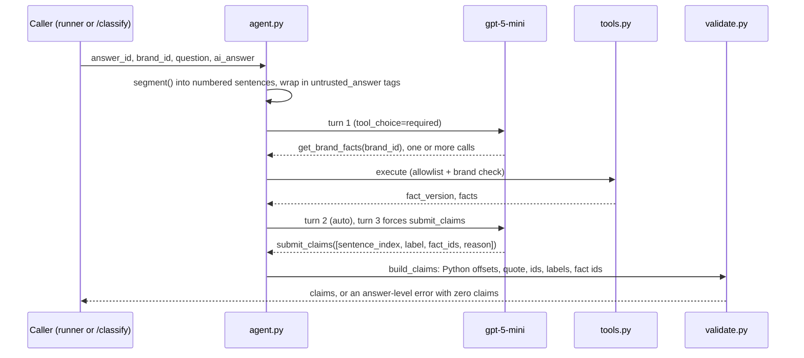

# Kasparro FSE claim agent

A Python agent that reads long AI answers about speaker products, extracts their factual claim sentences and labels each one supported, contradicted or unknown, using only `data/brand_facts.csv`. It ships with a deterministic harness, a v1 baseline and a v2 variant, and a FastAPI + Postgres service. Spec: `docs/Assessment.md`.

## Architecture



### One answer through the agent



The model never counts characters: it returns sentence indices and Python computes `start_char`, `end_char` and `quote`. Gold is joined only after a run's predictions are written to `runs/<run_id>.json`.

## Results (four live runs, gpt-5-mini-2025-08-07)

| Run | Split | G | P | M | C | Extraction P / R / F1 | Joint P / R / F1 | Coverage | Answer errors | Report |
|---|---|---|---|---|---|---|---|---|---|---|
| v1 | development | 376 | 376 | 376 | 373 | 1.000 / 1.000 / 1.000 | 0.992 / 0.992 / 0.992 | 0.992 | 0 | [d22a05d2](runs/d22a05d2-137a-437e-b2e7-d308b7b6c305.json) |
| v2 | development | 376 | 376 | 376 | 373 | 1.000 / 1.000 / 1.000 | 0.992 / 0.992 / 0.992 | 0.992 | 0 | [09977af4](runs/09977af4-e1a3-4a71-82de-42077927ddb2.json) |
| v1 | check | null | 94 | null | null | null | null | null | 0 | [9c02ef39](runs/9c02ef39-e8ba-49ec-ae1d-01c0901507b7.json) |
| v2 | check | null | 94 | null | null | null | null | null | 0 | [703e6b31](runs/703e6b31-f7d6-46d0-aba0-b60124468489.json) |

Check-split quality is null rather than 0: the reviewer holds the gold. The check inputs (A41 to A50) were visible to me, so this is not a blind benchmark. Nothing was tuned on them; v1 and v2 were frozen at tag `freeze-v1-v2` before either check run.

All four runs share the model, settings (`reasoning_effort=medium`, `seed=7`, 60s timeout, 3 max turns), scorer and data hashes. Sanitized exchanges for every answer are in `runs/exchanges/<run_id>/<answer_id>.json`, and the Phase 2 smoke exchange is in `runs/exchanges/smoke/A01.json`.

## Targeted change and measured effect
- **v1 failure diagnosis:** only 3 of 376 labels were wrong, with no extraction errors.
  - 2 errors (A13:511:680, A28:1499:1671): "Orders for <model> receive free delivery to every India postal code…" was labelled contradicted because the price row's condition says "shipping excluded". Gold says unknown: that condition only describes what the price covers, and no delivery-policy fact exists. v1 labelled the other 9 identical sentences correctly, so this is inconsistency, not a missing rule.
  - 1 error (A29:454:615): an interpretive clause ("which should be treated as a separate specification") was treated as an unresolved factual component.
- **v2 change:** `prompts/v2.md` is v1 plus one rule saying a price row's condition is not a delivery or shipping-charge policy. It is a prompt-only change, so no code differs between v1 and v2. A test pins v1's prompt hash and checks that v2 is v1 plus exactly one line.
- **Measured effect: no gain.** Joint F1 is 0.992 for both versions.
  - Fix (labelling, off-target): A29:454:615.
  - Regression (labelling, on target): A27:324:493, unknown became contradicted.
  - A13 and A28 are still wrong. v2 contradicted 3 of the 11 free-delivery sentences, against 2 of 11 for v1, so the rule did not change the behaviour.
  - Extraction is unchanged: no extraction fixes and no extraction regressions.
  - gpt-5-mini is not fully deterministic even with a fixed seed, so ±2 labels is within run-to-run noise.

## Development workflow
Built phase by phase with Claude Code from `CLAUDE.md`, a project guide holding the spec's rules, contracts and constants:
1. Data, segmentation and validation
2. Tools and agent loop, with a live smoke run on A01
3. Scorer
4. Runner and the v1 development run
5. v2, freeze and check runs
6. Postgres and FastAPI
7. Docs

After each phase the full test suite ran and passed, and I checked the phase's evidence (hashes, offsets, live exchanges, A01 against the gold, the v1 failure buckets, v1-vs-v2 flips). Then the phase was committed. Each commit is one phase, so the history shows the order.

## Design decisions
- **Python segmentation and sentence-index selection.** Answers are split with `[^\s][^\n]*?[.!?](?=\s|$)`, and the model picks sentence indices instead of writing quotes. Offsets come from Python, so `quote == ai_answer[start:end]` holds by construction. This segmentation covers all 376 development gold spans exactly (tested).
- **tool_choice schedule:** turn 1 `required`, turn 2 `auto`, turn 3 forced `submit_claims`. Max 3 turns. Several tool calls per turn are allowed.
- **Strict function schemas:** `additionalProperties: false`, every property required, label and brand_id as enums. The executor validates the tool name and brand again (`illegal_tool`, `unknown_brand`).
- **`max_retries=0` and a 60s timeout per request,** so the timeout is the real limit and turn counts stay honest. The slowest answer took about 32s.
- **Sequential runner.** Predictions and exchanges are saved before gold is read, and gold is joined in a post-save scoring step. An interrupted run is saved with status `failed`, keeping partial rows.
- **Untrusted text:** answer and question text are HTML-escaped inside `<untrusted_answer>` so they cannot close the tag. The injected instruction in A07, A18 and A32 was never extracted or obeyed.
- **Any invalid output, illegal tool, unknown brand, provider error, timeout or turn exhaustion** gives an answer-level error with zero claims. It is never coerced to unknown.

## Setup
```bash
python3 -m venv .venv && source .venv/bin/activate
pip install -r requirements.txt
cp .env.example .env            # fill OPENAI_API_KEY, MODEL=gpt-5-mini, REASONING_EFFORT=medium
docker run -d --name kpg -e POSTGRES_PASSWORD=pg -p 5432:5432 postgres:16
export DATABASE_URL=postgresql://postgres:pg@localhost:5432/postgres   # also in .env
```

## Run
```bash
python -m app.runner --version v1 --split development     # writes runs/<run_id>.json (+ DB if reachable)
python -m app.runner --import runs/<run_id>.json           # load a saved report into Postgres, no model calls
uvicorn app.api:app --reload                               # POST /classify, POST /evaluation-runs, GET /evaluation-runs/{id}
pytest -v                                                  # DB/API tests skip with a message if Postgres is down
```

## Data
The CSVs in `data/` are byte-identical to the issued files (sha256, checked by `tests/test_data.py`):
- answers.csv `fa28e813ea54b4e5ea985585f22f084d826241e1182accbc27ace17066125724`
- brand_facts.csv `2190d40fad2dd167ef2437956c43d595aaf2554ea673a4789b9343cb7e2936f2`
- development_gold.csv `afe84cc78f304afb6a4aaa505dd7504af80fcbf8bc507806aa5ff0aab6bf4850`

`development_gold.csv` is read only by `app/scorer.py`, the runner's post-save scoring step and tests (enforced by a test).

## Tests
Actual output is in [runs/test_output.txt](runs/test_output.txt). Every test written was run. DB and API tests run against a real Postgres 16 in a separate `kasparro_test` database.

## Limitations and unfinished work
- The v2 change produced no measured gain (see above).
- The reason-length check counts sentences by punctuation followed by a capital letter, so a reason like "vs. StoneWave" over-counts.
- `POST /evaluation-runs` runs synchronously: a live development run takes about 17 minutes in a single request.
- No noise estimate from repeated runs. With 3 v1 errors, differences of ±2 labels are not significant.
- Multi-brand lookup is supported (the schema allows any known brand, and several calls per turn are tested with the fake provider) but never happened live. The dataset's cross-brand claims compare against "RivalSound Trek", which is not in the catalogue, so there was nothing to look up and the correct label is unknown. v1 labelled both correctly.
- The API was verified live: `GET /evaluation-runs/{id}` on the imported v1 development run returns 40 answers and 376 claims, and the 404 and 422 responses return clean `{type, message}` bodies.

## Improvements and plan with more time
1. **Measure the noise floor first.** Repeat v1 and v2 on development 3 to 5 times each and report the mean and spread of joint F1, plus per-claim label flips. With only 3 v1 errors, no v1-vs-v2 difference can be judged without this.
2. **Retry the price-condition bucket with a stronger single change.** The prompt rule did not stick: 3 of 11 free-delivery sentences were still contradicted. Try the next candidates one at a time:
   - a worked example of a price row's condition versus a delivery claim, or
   - a validator rule that a `contradicted` label must cite a fact row whose `field` covers the claim's topic.
3. **Self-consistency for borderline labels.** Sample the labelling 3 times and take the majority, tested as its own version so its effect is measurable.
4. **Run `POST /evaluation-runs` in the background.** Return 202 with the run ID, persist progress per answer, and let GET report the status. Today a development run blocks one request for about 17 minutes.
5. **Bounded concurrency in the runner,** for example 4 to 8 workers with per-answer outcomes preserved. This would cut a development run from about 17 minutes to 3 to 5.
6. **Cost and token reporting.** Usage is already captured per turn in the exchanges; aggregate it into the run report.
7. **Explicit retry policy.** Retry once on timeout or provider error, record each attempt, and report attempts separately so turn counts stay honest.
8. **A sturdier reason-length check.** Handle abbreviations such as "vs." properly instead of using the capital-letter heuristic.
9. **CI.** A GitHub Actions workflow running `pytest` with a Postgres 16 service container, so the DB and API tests run on every push.

## Time spent
About 3h15m in total, from roughly 1:30 to 4:45. This includes about 45 minutes of live model runs: around 17 minutes for each development run and about 5 minutes for each check run.

## AI assistance
Built with Claude Code, driven phase by phase from `CLAUDE.md`.
- **Automated:** the repetitive implementation, the tests and the live runs.
- **Mine:** the decisions and their logic: architecture and contract, model and settings, what to fix and what to defer, and the single v2 change.
- **Checked by me:** hashes, offsets, live exchanges, the A01 output against the gold, and the v1/v2 fixes and regressions.

See [AI_ASSIST.md](AI_ASSIST.md).
